

  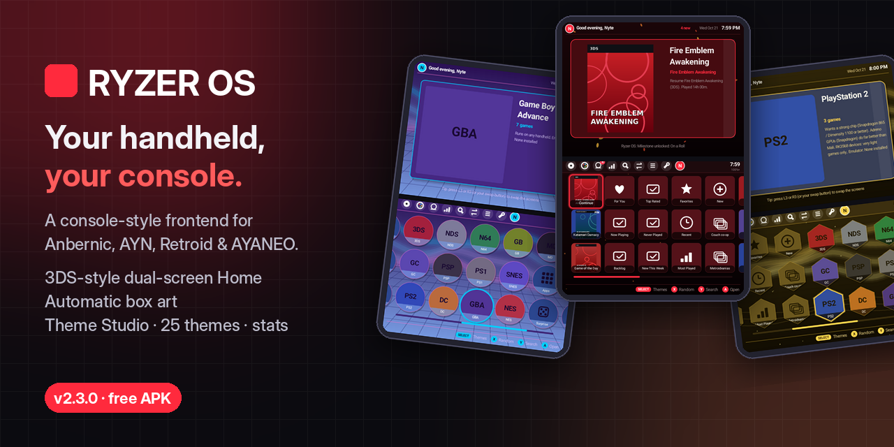

<h1 align="center">Ryzer OS</h1>

  <b>A console-style frontend for retro handhelds.</b> 
  3DS-style dual-screen Home · Theme Studio · 25 themes · notifications · play stats · mini-games

  
  
  

  <a href="https://github.com/NyteRyzer/RyzerOS/releases/latest/download/RyzerOS.apk"><b>⬇ Download the APK</b></a> ·
  <a href="https://github.com/NyteRyzer/RyzerOS/releases/latest/download/RyzerOS-Linux.zip">Linux edition</a> ·
  <a href="https://nyteryzer.github.io/RyzerOS/">Website</a> ·
  <a href="https://nyteryzer.github.io/RyzerOS/releases.html">Releases</a> ·
  <a href="CHANGELOG.md">Changelog</a>

---

Ryzer OS replaces your handheld's home screen with a fast, good-looking console dashboard. It finds your games, launches them in the emulators you already have, and makes the most of a second screen. Install it on the **stock Android OS** like Cocoon or iiSU; no root and no flashing. For custom firmware, there's a [Linux edition](docs/LINUX.md).

## Screenshots

Real captures of Ryzer OS 2.1 running with a sample library. Each one shows the top and bottom screen of a dual-screen handheld.

<table>
  <tr>
    <td align="center" width="33%">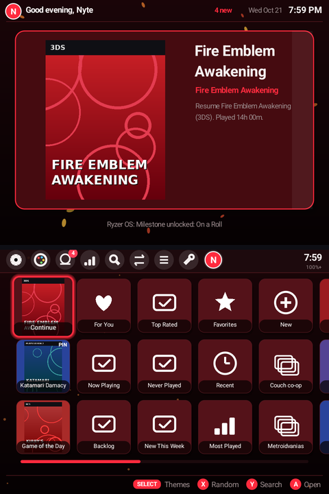 <b>3DS-style Home</b></td>
    <td align="center" width="33%">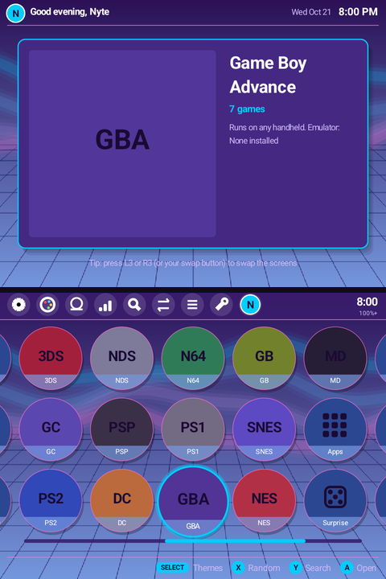 <b>Neon mode + live wallpaper</b></td>
    <td align="center" width="33%">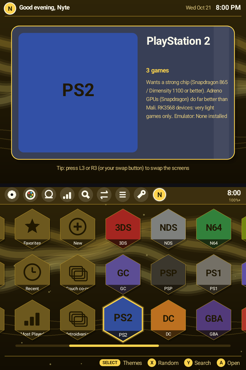 <b>Unlockable bonus themes</b></td>
  </tr>
  <tr>
    <td align="center" width="33%">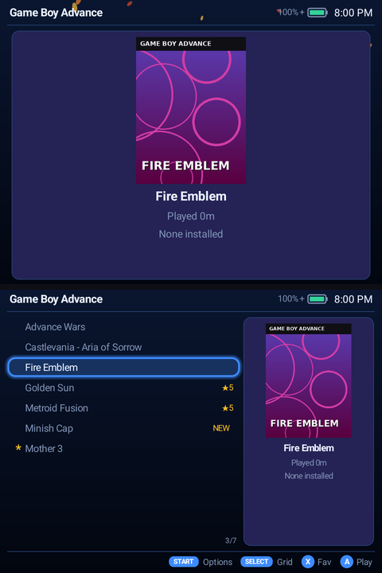 <b>Game lists with box art</b></td>
    <td align="center" width="33%">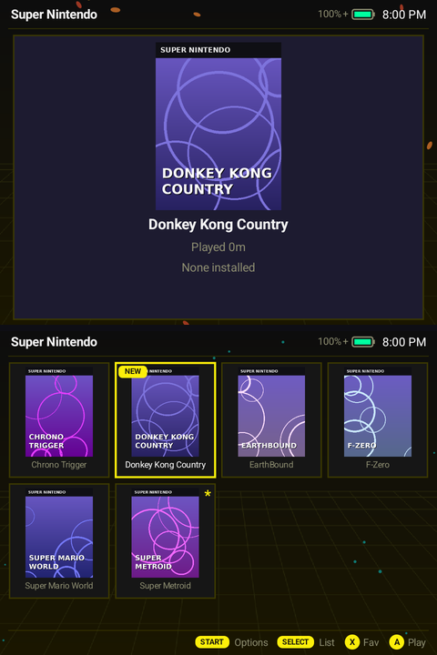 <b>Grid view</b></td>
    <td align="center" width="33%">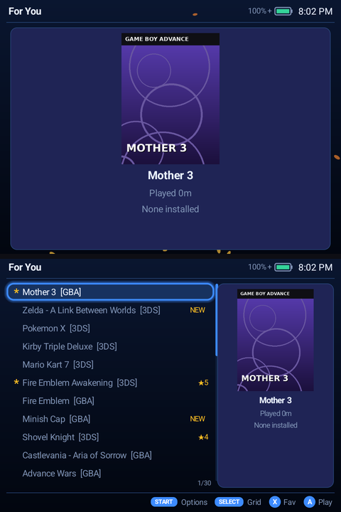 <b>For You picks</b></td>
  </tr>
  <tr>
    <td align="center" width="33%">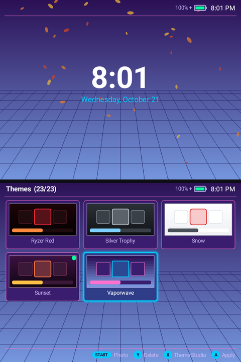 <b>25 themes, live preview</b></td>
    <td align="center" width="33%">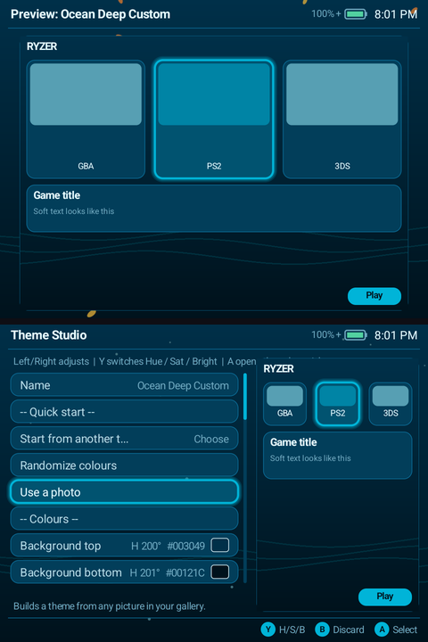 <b>Theme Studio</b></td>
    <td align="center" width="33%">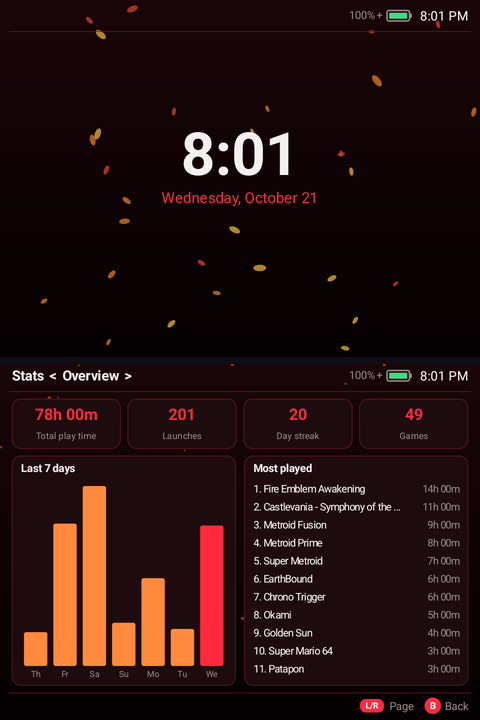 <b>Play stats</b></td>
  </tr>
  <tr>
    <td align="center" width="33%">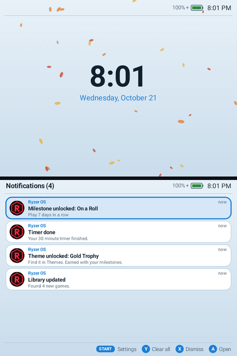 <b>Notification centre</b></td>
    <td align="center" width="33%">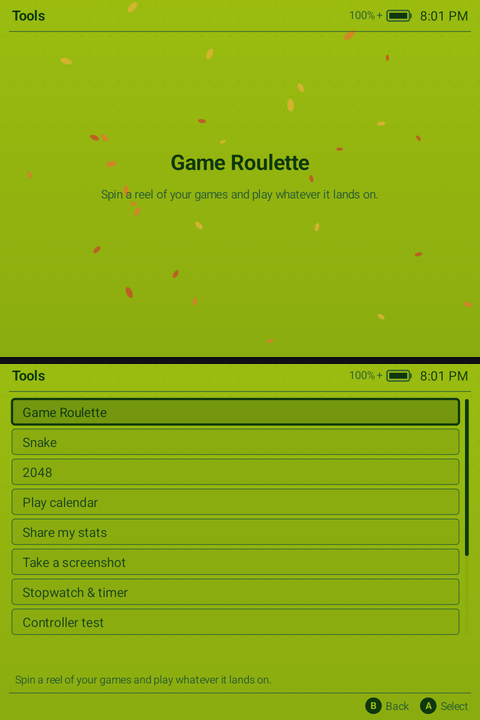 <b>Tools & mini-games</b></td>
    <td align="center" width="33%">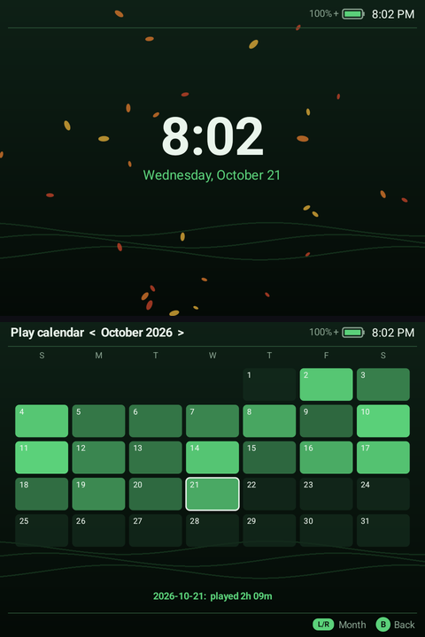 <b>Play calendar</b></td>
  </tr>
</table>

<table>
  <tr>
    <td align="center" width="50%">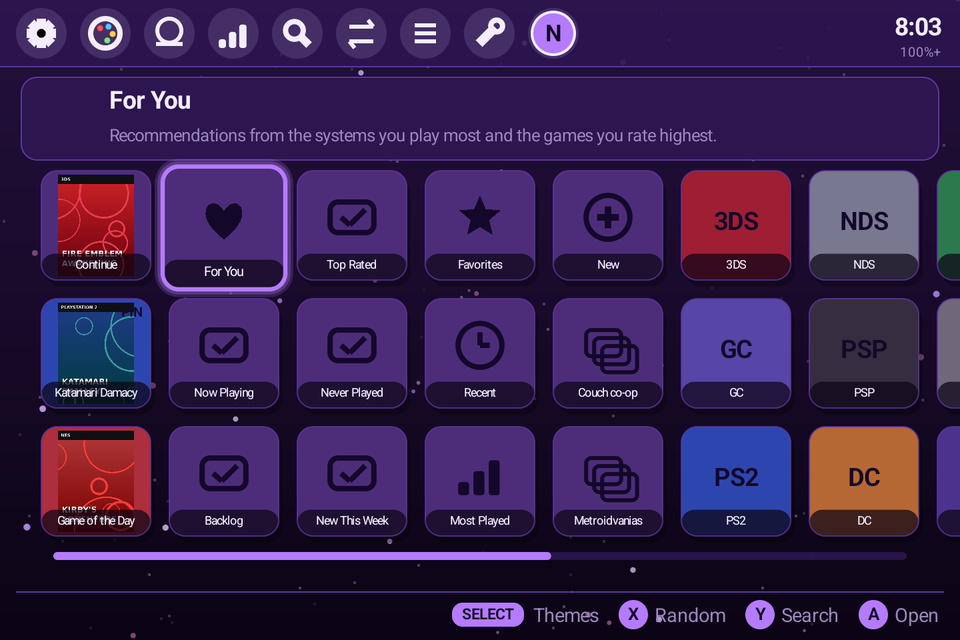 <b>Single-screen handhelds (Retroid, Odin...)</b></td>
    <td align="center" width="50%">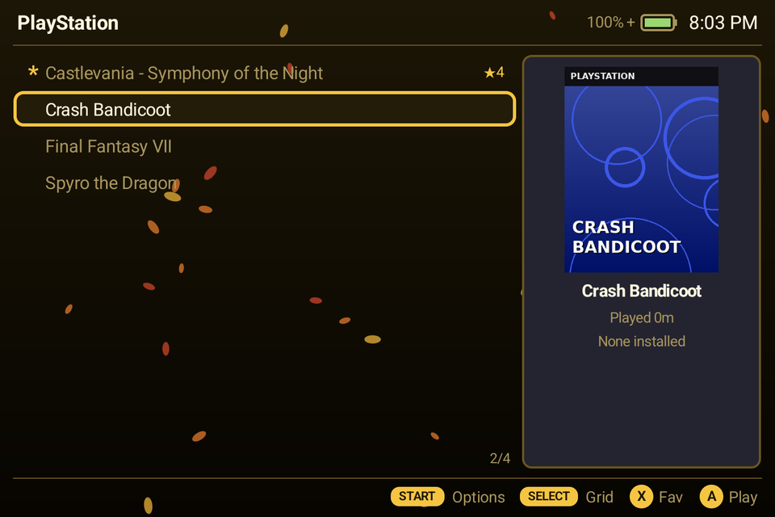 <b>Game list with details panel</b></td>
  </tr>
</table>

More screenshots (2048, Game Roulette, quick menu, the classic ribbon layout) are on the [website](https://nyteryzer.github.io/RyzerOS/#screens).

## Highlights

- **3DS-style Home**: a floating 3D banner for the selected game or system on the top screen, and a sideways-scrolling icon grid with a toolbar on the bottom. Prefer something else? The classic **Ribbon** and **Grid** layouts are one setting away.
- **Real dual-screen play** on the RG DS, AYN Thor, AYANEO Pocket DS and Retroid Dual. GBA, SNES, PSP and other single-screen games open on one screen, with a **Now Playing** touch panel on the other: timer, volume, notes, ratings and emulator controls. **Swap the screens mid-game** from the panel. DS and 3DS games get both screens. In the menus, **L3 / R3** swaps the screens.
- **Theme Studio**: design every colour, pattern, live wallpaper, font, corner and panel. You can also make a theme from any photo, and share themes as codes.
- **25 themes**: 20 built in, plus 5 bonus themes you unlock with milestones. There are also 10 live wallpapers, seasonal effects, neon mode and 4 icon shapes.
- **Automatic artwork**: Ryzer reads each ROM, identifies the game in the libretro database (No-Intro, Redump, FBNeo) and downloads its box art, screenshot or title screen. No account is needed, and your ROM folders are never touched.
- **Notification centre**: your Android notifications in Ryzer, with banners and do not disturb.
- **A smarter library**: For You picks, smart collections, NEW badges, ratings, a backlog tracker, collections, and search across games, apps and settings.
- **Stats**: play time, streaks, a play calendar, session history, 14 milestones and a shareable stats card.
- **Extras**: Snake, 2048, Game Roulette, a controller tester, battery info, a stopwatch and timer, a bedtime reminder, a quick menu (L + R) and kid mode.

## New in 2.3: swap screens mid-game, automatic updates

- **Swap screens while you play**: on dual-screen handhelds, tap **⇅ Swap screens** on the Now Playing panel (or swipe it) to move a GBA, SNES, PSP or other single-screen game to the other screen. The game keeps running and keeps your controller, and Ryzer remembers the choice for that system. Needs Android 10 or newer.
- **Automatic updates**: Ryzer checks for new versions once a day on Wi-Fi, downloads them and asks before installing. Your settings and play history are kept. See *Settings → Updates*.

## New in 2.2: automatic artwork

Ryzer now finds pictures for your games by itself. It reads each ROM's checksum (instant for `.zip` files) and looks it up in the libretro game database, so even a file called `the_legend_of_zelda_minish_cap.gba` gets the right cover. Then it downloads the art from the free libretro thumbnail library. Discs and big files are matched by name instead.

- Runs automatically after each library scan (Wi-Fi only by default), or on demand: **Settings → Library → Artwork**, or **Find artwork online** in any game's options
- Box art, screenshots or title screens, for 26 systems from NES to PS2, GameCube, 3DS and arcade
- Saved small in `RyzerOS/covers`; art you already have always wins

## What's new in 2.1

30 new features. A few favourites:

- **For You** recommendations and **smart collections** that fill themselves
- **Game Roulette**, plus the **Snake** and **2048** mini-games
- **5 unlockable bonus themes** and **4 new live wallpapers** (fireflies, leaves, hearts and matrix)
- **Neon mode**, **icon shapes**, **binary and word clocks**, and **seasonal effects**
- **Play calendar**, a **shareable stats card**, and **screenshots** of Ryzer itself
- **"Continue playing?"** when Ryzer starts

See the [full list in the changelog](CHANGELOG.md#210-30-new-features).

## Works on

| | Devices |
| --- | --- |
| **Dual screen** | Anbernic RG DS · AYN Thor · AYANEO Pocket DS · Retroid Dual (and tall single displays, split in two) |
| **Android handhelds** | Retroid Pocket 4 Pro / 5 / 6 / Mini / Flip / Classic · AYN Odin 2 / 3 / Portal · Anbernic RG 406H / 556 / 557 / Cube / 477M · any Android 6+ device |
| **Custom firmware** | ROCKNIX · Knulli / Batocera · muOS · ArkOS, through the [Linux edition](docs/LINUX.md) |

## Install (Android)

1. On the handheld, open the release page in the browser and download `RyzerOS-<version>.apk`.
2. Open the downloaded file. If Android asks, allow your browser or file manager to **install unknown apps**.
3. Start **Ryzer OS** and grant **All files access** so it can find your games.
4. Optional: go to **Settings → Set as home screen** to make Ryzer your home screen, like Cocoon or iiSU.
5. Put games in `ROMs/<system>` folders (`ROMs/3ds`, `ROMs/gc`, `ROMs/ps2`, `ROMs/switch`, `ROMs/nds`...) on internal storage or the SD card. ES-DE folder names work too. You can add other folders under **Settings → Library → ROM folders**.

Updating? Install the new APK over the old one. Your settings, themes and play history are kept in the `RyzerOS` folder.

**Emulators:** Ryzer launches the emulators you already have installed. It knows how to start 27 of them directly: Azahar, Citra MMJ, Lime3DS, Mandarine, Dolphin, NetherSX2, ARMSX2, Eden, Cemu, DuckStation, DraStic, melonDS, PPSSPP, Flycast, Redream, M64Plus FZ, Yaba Sanshiro 2, Pizza Boy, My Boy!, RetroArch (any core) and more. The launch settings follow ES-DE's tested Android configuration. Any other emulator works through **Emulators → Any app** or **Ask every time**. You choose the emulator for each system under **Settings → Emulators**.

## What to expect

Ryzer is a frontend. It makes finding and launching games fast and good-looking, but the emulators do the emulating, so how well the heavy systems run depends on your chip:

| Chip class (examples) | 3DS | GameCube / Wii | PS2 | Switch |
| --- | --- | --- | --- | --- |
| RK3568 (RG DS, RG 353) | Light games | A few light games | Very light games | No |
| Unisoc T618/T820 (RG 405/406, RP4) | Many games | Many 2D/light 3D | Light games | No |
| Dimensity 1100 / SD 865 (RP4 Pro, Odin 1) | Most games | Most games | Many games | Light games |
| Snapdragon 8 Gen 2+ (AYN Thor, Odin 2/3, RP5/6) | Full library | Most games | Most games | Many games |

Each system's tile shows what it needs, so you know before you press A. On Android, Ryzer can't change CPU clocks without root. Use your device's own performance mode, and Ryzer's **Boost** option frees RAM before heavy games.

## FAQ

**Is it a real operating system?** No, and it doesn't need to be. The Android edition is a launcher app on your stock OS, and the Linux edition runs on top of ROCKNIX, Knulli, muOS or ArkOS. Ryzer changes how the handheld looks and feels, while the firmware keeps providing the drivers.

**Does it include games or emulators?** No. Bring your own legally obtained games and install the emulators you like. The titles and covers in the screenshots are placeholders from a sample library.

**Something broke?** If Ryzer ever closes by itself, it saves the error to `RyzerOS/crash.txt` and shows it the next time it starts. [Open an issue](https://github.com/NyteRyzer/RyzerOS/issues) and paste it in.

## For tinkerers

- Themes are plain JSON files: in `ryzer/themes/` for the built-in ones and in `RyzerOS/themes` on your device for yours. Theme Studio writes them for you.
- Systems and emulators are defined in `systems.json` and `emulators.json`. Copy them into the `RyzerOS` folder to change how games launch.
- The [Linux edition guide](docs/LINUX.md) covers installing on custom firmware, the speed profiles, the source layout and developing on a PC.
- [tools/screenshots](tools/screenshots) re-takes every screenshot on this page in an Android emulator (the **screenshots** workflow).
