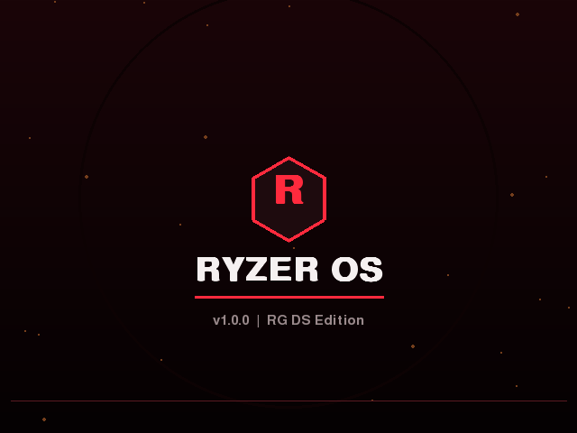
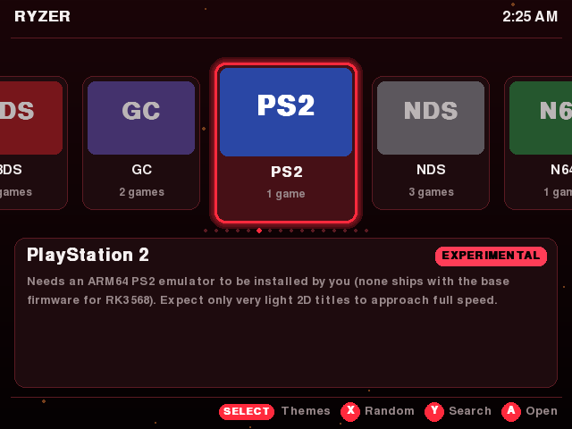
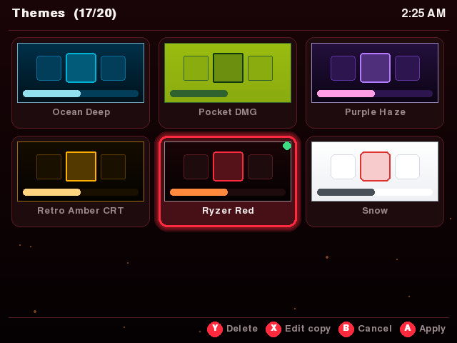
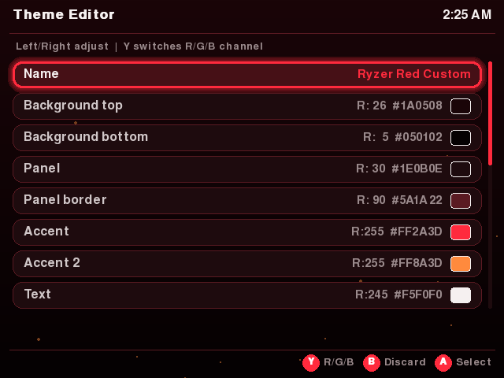

# Ryzer OS

**A console-style frontend for retro handhelds.** It includes a dashboard, dual-screen support, 20 themes, an on-device theme editor, and speed tuning for the heavy consoles (3DS, GameCube, PS2 and Switch).

Ryzer OS comes in two editions that share the same look and the same themes:

| Edition | For | Install |
| --- | --- | --- |
| **Android** (APK) — main edition | The **stock OS** on Anbernic (RG DS, RG 406H/556/557, RG Cube, RG 477M...), AYN (Thor, Odin 2/3, Odin Portal), Retroid (Pocket 4 Pro/5/6/Mini/Flip/Classic/Dual), AYANEO Pocket DS and any Android 6+ handheld | Download the APK and open it, like Cocoon or iiSU |
| **Linux** (zip) — fallback for custom firmware | Devices running ROCKNIX, Knulli/Batocera, muOS, ArkOS | Unzip and run `install.sh` |

## Download

**Android APK (direct link):** https://github.com/NyteRyzer/RyzerOS/releases/latest/download/RyzerOS.apk

**Linux zip (direct link):** https://github.com/NyteRyzer/RyzerOS/releases/latest/download/RyzerOS-Linux.zip

Every version is listed on the [Releases page](https://github.com/NyteRyzer/RyzerOS/releases). The newest one is marked **Latest**.

If Ryzer ever closes by itself, it saves the error to `RyzerOS/crash.txt` and shows it the next time it starts. Send that text along with your bug report.

### New in 2.1: 30 new features

**Play**
1. **Snake**, a mini-game with saved high scores (Tools).
2. **2048**, the other mini-game, also with high scores.
3. **Game Roulette**: a slot-machine reel spins through your games and you play whichever it lands on.
4. **Launch animation**: the box art zooms in before the game starts.
5. **"Continue playing?"** at startup offers your last game, along with your notes for it.

**Library**
6. **For You**: recommendations from the systems you play most and the games you rate highest.
7. **Smart collections** that fill themselves: Now Playing, Backlog, Top Rated, Never Played and New This Week.
8. **NEW badges** on games added in the last 7 days.
9. **Search everything**: Y finds games, Android apps and Ryzer screens in one place.
10. **ROM check (CRC32)** in any game's options, to spot a damaged file.
11. **Per-system backgrounds**: `RyzerOS/backgrounds/gba.jpg` shows behind your GBA list.

**Look**
12. **Home tile editor**: choose which Home tiles appear.
13. **Icon shapes** for the 3DS layout: rounded, circle, square or hexagon.
14. **Neon mode**: glowing outlines on every panel.
15. **Screen transitions**: screens slide in as they open.
16. **Binary clock**, a new top-screen clock style.
17. **Word clock** ("quarter past seven"), another new clock style.
18. **4 new live wallpapers**: fireflies, leaves, hearts and matrix.
19. **Seasonal effects**: snow in winter, petals in spring, fireflies in summer, leaves in autumn and hearts on Valentine's Day.
20. **Photo-frame screensaver**, using your pictures in `RyzerOS/photos`.
21. **Custom boot message**.
22. **5 unlockable bonus themes** (Bronze, Silver, Gold, Platinum, Ryzer Legend) that you earn with milestones.

**Tools** (a new Home tile, toolbar button and Settings entry)
23. **Play calendar**: a month view of the days you played, shaded by how long.
24. **Share my stats**: makes a picture card of your stats and opens the share menu.
25. **Screenshots** of Ryzer, from the Tools or Quick menu.
26. **Stopwatch and timer**, with laps; the timer sends a notification when it finishes.
27. **Controller test**: every button, stick and trigger, live.
28. **Battery info**: charge, temperature, voltage, current and health.
29. **System brightness** control and a **bedtime reminder**.
30. **What's New** and **Help & tips** screens.

### New in 2.0

- **New 3DS-style Home** (default): the top screen shows a big floating banner for the selected item, with your profile, the clock, the date and notifications. The bottom screen has a toolbar (Settings, Theme Studio, Notifications, Stats, Search, Swap, Quick menu, Profile) above a sideways-scrolling grid of icons. Ryzer's glow, colour bands and themes are all still there. The Ribbon and Grid layouts are one setting away (Personalize → Look & feel → Home layout).
- **Theme Studio**, a full designer:
  - all 12 colours, picked from a palette or fine-tuned by hue, saturation and brightness
  - 10 background patterns, plus the theme's own live wallpaper, picture, picture dimming and font
  - panel opacity (glass), tile style, corner roundness, text size and particles
  - a readability check with one-press auto-fix, random palettes, and copying another theme as a starting point
  - share codes that friends can import
- **Notification centre**: your Android notifications in Ryzer, with slide-down banners, an unread badge, open, dismiss, clear all and do not disturb. They also appear on the Now Playing screen while you play. Switch it on once under Settings → Notifications → START → Allow notification access.
- **Screen swap button**: L3 or R3 swaps the two screens instantly. You can also set any other button (Settings → Display & dual screen → Swap button) or use the toolbar or quick menu.
- **Live wallpapers**: aurora, starfield, bubbles, rain, snow and waves, tinted by your theme, with adjustable speed.
- **Profile**: your name and picture on the top screen and toolbar.
- **More menus**: Personalize, Notifications, Profile and Notification settings, plus swap and do not disturb in the quick menu.

### New in 1.2: dual-screen play

On dual-screen handhelds (RG DS, AYN Thor, AYANEO Pocket DS, Retroid Dual), **single-screen systems** such as GBA, SNES, PSP, PS1, N64 and GameCube open the game on one screen. The other screen becomes a **Now Playing** touch panel showing:
- box art, title, system and emulator
- a live session timer, total play time and time left under your daily limit
- the clock and battery
- touch controls: volume, mute, favorite, rating, status, emulator controls, your notes, break reminder, screen off, and back to Ryzer

DS and 3DS games still get both screens. If games open on the wrong screen, switch **Settings → Display & dual screen → Single-screen games open on**.

### New in 1.2: 20 more features

1. **Photo themes**: pick any picture from your gallery and Ryzer builds a full theme from its colours, with the photo as the background (Themes → START, or Look & feel)
2. **Glass panels**: see-through panels over wallpapers and photo themes
3. **Box-art colours**: panels take on the colours of the selected game's art
4. **System colours**: the accent colour matches the system you're on
5. **RGB mode**: slowly cycling rainbow accents
6. **Night light**: a warm filter for night-time play
7. **Custom system tiles**: your own picture for any system (`RyzerOS/tiles/gba.png`)
8. **Grid Home layout** as an alternative to the console ribbon
9. **Menu music** from your own songs in `RyzerOS/music`, paused during games
10. **Sound packs**: Classic, Chiptune or Soft
11. **Greeting with your name** on the top screen
12. **Game of the Day** tile, favouring games you haven't played
13. **Pin games to Home**
14. **Session history**: your last 100 sessions in Stats
15. **Game notes** (codes, where you left off), also shown on Now Playing
16. **Break reminder** on the Now Playing screen
17. **Daily play limit**, enforced in kid mode
18. **Emulator controls cheat sheets** (how to open each emulator's menu and save states; editable in `RyzerOS/hotkeys.json`)
19. **Swipe gestures** on the touch screens
20. **Boot animation styles**: Classic, Glitch or Minimal

Also: a **recently played shelf** on the top screen.

### What's in the Android edition

**Library**
1. **Collections**: make your own lists (e.g. "Couch co-op"), each with its own Home tile
2. **Hide games** you don't want to see, plus a "Show hidden games" switch
3. **Per-game emulator**: pick a different emulator for one game
4. **Sort** by name, last played, most played, rating, file size or recently added
5. **Filter** by favorites, never played, or completion status
6. **Rename games** (a display name only; the file is untouched)
7. **Star ratings** from 1 to 5
8. **Completion status**: Backlog, Playing, Beaten or Completed
9. **Most Played** list and Home tile
10. **Recently Added** list and Home tile
11. **Random pick** from any list (a system, a collection or favorites)
12. **Grid view** with box art (press SELECT in any game list)
13. **Duplicate finder** for the same game found more than once
14. **Storage by system**: how much space each system's games use
15. **Delete ROM** from the game's options, with a confirmation

**Stats**
16. **Play stats**: total time, launches and your top games
17. **7-day activity chart**
18. **Day streak** counter
19. **14 milestones** to unlock (e.g. "Marathon": 3 hours in one day)
20. **Session summary** after each game ("You played Kirby for 42m")

**Look & feel**
21. **Screensaver**: drifting box art and a clock, with the screen dimmed
22. **Wallpapers**: put images in `RyzerOS/wallpapers`
23. **Theme of the day** or a **random theme** on every start
24. **Day / night themes** that switch automatically
25. **5 fonts** and **3 interface sizes**
26. **Home layout**: order systems (A-Z, most games, recently played) and hide the ones you don't use

**Device**
27. **Quick menu (L + R)** from anywhere: volume, mute, brightness, Wi-Fi, Bluetooth, free memory
28. **Vibration** on button presses
29. **Battery saver**: lighter menus below 20%, with warnings at 15% and 5%
30. **Kid mode**: hides settings, Apps and file actions behind a PIN

Also included: settings **backup and restore**, an **analog clock** style for the top screen, and **store links** for missing emulators.

### Android: install on the stock OS

1. On the handheld, open the release page in the browser and download `RyzerOS-<version>.apk`.
2. Open the downloaded file. If Android asks, allow your browser or file manager to **install unknown apps**.
3. Start **Ryzer OS** and grant **All files access** so it can find your games.
4. Optional: go to **Settings → Set as home screen** to make Ryzer your home screen, like Cocoon or iiSU.
5. Put games in `ROMs/<system>` folders (`ROMs/3ds`, `ROMs/gc`, `ROMs/ps2`, `ROMs/switch`, `ROMs/nds`...) on internal storage or the SD card. ES-DE folder names work too. You can add other folders under **Settings → Library → ROM folders**.

**Emulators:** Ryzer launches the emulators you already have installed. It knows how to start 27 of them directly: Azahar, Citra MMJ, Lime3DS, Mandarine, Dolphin, NetherSX2, ARMSX2, Eden, Cemu, DuckStation, DraStic, melonDS, PPSSPP, Flycast, Redream, M64Plus FZ, Yaba Sanshiro 2, Pizza Boy, My Boy!, RetroArch (any core) and more. The launch settings follow ES-DE's tested Android configuration. Any other emulator works through **Emulators → Any app** or **Ask every time**. You choose the emulator for each system under **Settings → Emulators**.

**Dual screen (Android):** on devices with a second display (AYN Thor, RG DS, AYANEO Pocket DS, Retroid Dual), Ryzer puts the menu on one screen and the clock, box art and game details on the other. **Swap screens** flips them, and you can tap either screen. While a game is running, Ryzer releases the second screen so DraStic, melonDS or Azahar can use both screens themselves.

```
 ┌──────────────── top screen ────────────────┐
 │                  2:23                      │   clock, box art,
 │           Wednesday, October 14            │   game details
 │      Total play time 1h 30m                │
 ├────────────── bottom screen ───────────────┤
 │  [3DS]  [GC]  [ PS2 ]  [NDS]  [N64]        │   console-style tile ribbon
 │  PlayStation 2              EXPERIMENTAL   │   honest speed rating per system
 │  (X) Random  (Y) Search  (A) Open          │
 └────────────────────────────────────────────┘
```

| Boot | Home | Themes | Theme editor |
| --- | --- | --- | --- |
|  |  |  |  |

Dual-screen layout (Neon Night theme): [docs/screenshots/dual/01-home.png](docs/screenshots/dual/01-home.png)

## What Ryzer OS is (and isn't)

Neither edition replaces the kernel. The **Android edition** is a launcher app that runs on the stock OS. The **Linux edition** runs **on top of a custom firmware** (ROCKNIX, Knulli, muOS or ArkOS), which supplies the kernel, drivers and emulators. Ryzer OS replaces how the device looks and feels and tunes how hard it runs:

| Part | What it does |
| --- | --- |
| `ryzer/` | The frontend: dashboard, game lists, search, favorites, themes, theme editor, settings. It's plain Python and pygame, so you can change anything. |
| `system/ryzer-perf` | Switches CPU, GPU and memory clocks between **Battery / Balanced / Performance / Turbo**. |
| `system/ryzer-tune` | Boot tweaks: 1.5 GB zram compressed swap, VM and scheduler tuning, SD read-ahead, and THP for JIT emulators. |
| `ryzer/tweaks.py` | One button that sets Azahar (3DS), Dolphin (GC) and AetherSX2 (PS2) to their fastest settings. It backs up the originals first. |

Writing a kernel and drivers from scratch for one handheld isn't realistic, and it wouldn't make games run faster. The speed comes from clocks, memory and emulator settings, and Ryzer OS controls all three.

### Honest performance expectations

How well each system runs depends on the device's chip. The Android edition shows each system's requirements on its tile (for example, "Wants a flagship chip (Snapdragon 8 Gen 2 class)"). Roughly:

| Chip class (examples) | 3DS | GameCube / Wii | PS2 | Switch |
| --- | --- | --- | --- | --- |
| RK3568 (RG DS, RG 353) | Light games | A few light games | Very light games | No |
| Unisoc T618/T820 (RG 405/406, RP4) | Many games | Many 2D/light 3D | Light games | No |
| Dimensity 1100 / SD 865 (RP4 Pro, Odin 1) | Most games | Most games | Many games | Light games |
| Snapdragon 8 Gen 2+ (AYN Thor, Odin 2/3, RP5/6) | Full library | Most games | Most games | Many games |

On Android, Ryzer can't change CPU clocks without root. Use the device's own performance mode (AYN, Retroid and Anbernic all have one). Ryzer's **Boost** option closes cached background apps before heavy games to free RAM.

#### Linux edition on the RG DS

The RG DS uses a **Rockchip RK3568**: 4× Cortex-A55 at 2.0 GHz, a Mali-G52 GPU and 3 GB of RAM. That's an entry-level chip. Software can make it run at its best, but it can't make it faster than its hardware allows. Turbo uses the highest *stock* clocks only. There's no overclocking, which could damage the device.

| System | On the RG DS | Notes |
| --- | --- | --- |
| NES, SNES, GB/GBC/GBA, Genesis, PS1, arcade | Full speed | |
| Nintendo DS | Runs well | Native dual-screen |
| N64, PSP, Dreamcast | Mostly playable | |
| **3DS** | **Light games only** | 2D and lighter 3D titles at 1x resolution. Big 3D games run below full speed. |
| **GameCube** | **Experimental** | Only a handful of lighter games get close to full speed. |
| **PS2** | **Experimental** | You have to install an ARM64 PS2 emulator yourself. Only very light titles get close to full speed. |

The dashboard shows this rating on every system tile, so you know what to expect before you launch a game.

## Features

- **Console-style dashboard**: animated tile ribbon, boot animation, button-prompt bar, clock, battery and Wi-Fi status
- **Dual-screen aware**: the top screen shows a big clock, box art and game details; the bottom screen is the menu. It also works on a single screen.
- **20 built-in themes**: Ryzer Red, Neon Night, Midnight Blue, Arctic, Forest, Sunset, Retro Amber CRT, Matrix,
  Vaporwave, Pocket DMG, Snow, Crimson Steel, Ocean Deep, Purple Haze, Gold Rush, Cherry Blossom, Carbon, Lava,
  Mint and Cyberpunk. Each one previews live as you browse.
- **Theme editor on the device**: change all 12 colors (R/G/B), the background style (gradient, scanlines, grid, dots, waves, stars), tile style, corner radius, text size and particles, then save under your own name
- **Per-system speed profiles**: 3DS, GameCube and PS2 switch to Turbo automatically when they launch, and the menu goes back to Balanced to save battery
- **Emulator speed tweaks**: one-button tuning for Azahar, Dolphin and AetherSX2, plus a restore option
- **Library**: automatic ROM scan, clean names that drop tags like "(USA) [!]", box art, favorites, recently played, play time and launch counts
- **Continue tile**: jumps straight back into your last game
- **Surprise me**: launches a random game
- **Search**: on-screen keyboard that searches every system
- **Letter jump** (L/R) and **page jump** (left/right) in game lists
- **Per-game options**: favorite, speed profile, game info and the exact launch command
- **System info**: live CPU clock, temperature, RAM, storage and battery
- **Screenshots** (SELECT + R), **dim when idle**, **button test**, **swap A/B**, menu sounds with volume control, and a 30/60 fps menu cap

## Install the Linux edition

You need **ROCKNIX** or **Knulli** (fully supported), or **muOS** or **ArkOS** (experimental). The installer detects which one you have.

1. On a PC, build the package (or download a release zip):
   ```sh
   ./build/package.sh            # -> dist/RyzerOS-1.0.0.zip
   ```
2. Copy the zip to the device and unzip it (for example to `/storage/RyzerOS` on ROCKNIX or `/userdata/RyzerOS` on Knulli).
3. On the device (over SSH, or with a terminal port), run:
   ```sh
   sh /storage/RyzerOS/install.sh          # add --boot to apply the speed tweaks at every boot
   ```
4. Open **Ports → Ryzer OS**. To return to the stock frontend, hold **SELECT + START** or use Power → Exit.

To uninstall, run `sh /storage/RyzerOS/uninstall.sh`. Add `--all` to also delete your themes and settings.

Ryzer reads the firmware's usual ROM folders (`/storage/roms`, `/userdata/roms`, `/mnt/sdcard/ROMS`, `/roms` and `/roms2`). Folder names are matched without regard to case.
Box art is picked up from an `images/` (or `media/images/`) folder next to the ROMs.

> **Status:** the Linux frontend, themes, installer and tuning scripts are tested on a PC (see `tests/`), including headless rendering at both screen layouts. The Android APK is compiled by CI on every push. Neither edition has been tested on real handheld hardware yet. If something doesn't work on your firmware, look at `/storage/ryzer/ryzer.log` first.

## Controls

| Where | Button | Action |
| --- | --- | --- |
| Anywhere | SELECT + START (hold) | Exit Ryzer OS |
| Anywhere | SELECT + R | Screenshot (saved to `/storage/ryzer/screenshots`) |
| Home | X / Y / SELECT / START | Random game / Search / Themes / Settings |
| Game list | A / X / START | Play / Favorite / Options |
| Game list | L / R | Jump to the previous / next letter |
| Themes | X / Y | Edit a copy / Delete a custom theme |
| Theme editor | Left/Right, Y | Adjust value, switch the R/G/B channel |

## Editing Ryzer OS

Everything is meant to be edited:

- **Themes** are JSON files. Built-in themes are in `ryzer/themes/` and your own go in `/storage/ryzer/themes/`. Copy one, change the hex colors and it shows up in the picker.
  ```json
  { "id": "my-theme", "name": "My Theme",
    "colors": { "bg_top": "#101020", "accent": "#FF2A3D", "...": "12 keys total" },
    "style":  { "background": "grid", "tile_style": "glow", "corner_radius": 12,
                "font_scale": 1.0, "particles": true } }
  ```
- **Systems and emulators**: copy `ryzer/data/systems.json` to `/storage/ryzer/systems.json` and edit it. Each system lists its ROM folders, file extensions and a fallback chain of launch commands. `ra:<core>` means RetroArch with that core.
- **Settings** are saved in `/storage/ryzer/config.json`, including key mappings and the default speed profile for each system.
- **The UI** is in `ryzer/screens/`. Each screen is a small class with `handle()`, `draw()` and `draw_top()` methods.

### Develop on a PC

```sh
pip install pygame-ce pytest
python3 -m ryzer --windowed --dry-run              # keyboard: arrows, Z=A, X=B, C=X, V=Y, Q/E=L/R, S=Start, A=Select
python3 -m ryzer --windowed --dry-run --layout dual
python3 tools/preview.py shots/                    # render every screen to PNG
python3 -m pytest
```

## Layout

```
android/          Android edition (Kotlin, no third-party libraries)
  app/src/main/assets/   systems.json + emulators.json (regenerate with tools/gen_android_data.py)
ryzer/            Linux edition frontend (Python) + the 20 shared themes
  screens/        boot, home, games, themes + editor, settings, keyboard
  themes/         20 built-in themes (JSON)
  data/           systems.json - systems, folders, emulator commands, speed ratings
system/           ryzer-perf (speed profiles), ryzer-tune (boot tweaks)
install/          install.sh / uninstall.sh
build/            package.sh - builds the installable zip
tools/preview.py  headless screenshot renderer
tests/            pytest suite (core logic + UI fuzzing)
```
